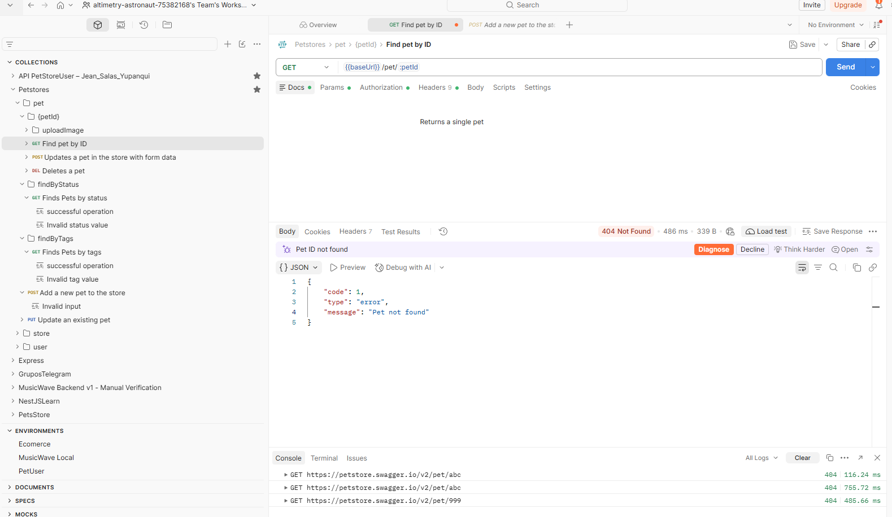
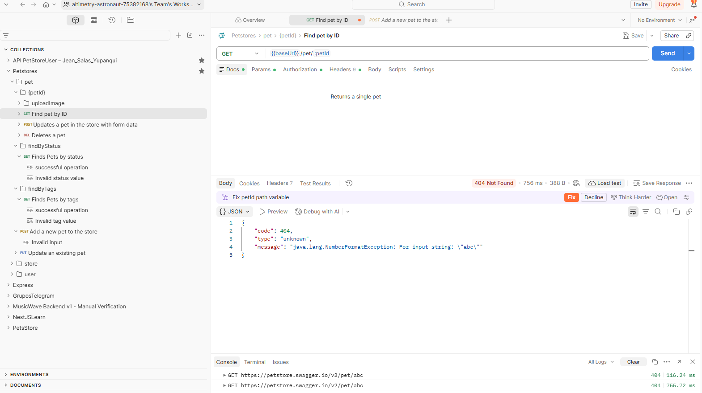

# Defectos detectados — Petstore API (recurso `pet`)

Hallazgos encontrados al comparar el contrato de Swagger (https://petstore.swagger.io/v2/swagger.json) con el comportamiento real de la API, usando Postman.

| ID | Título | Severidad propuesta | Estado |
|---|---|---|---|
| DEF-001 | `GET /pet/{petId}` con id no numérico responde 404 en lugar de 400 | Media | Abierto |
| DEF-002 | La API expone mensajes de excepción internos de Java al cliente | Baja | Abierto |

---

## DEF-001: `GET /pet/{petId}` con id no numérico responde 404 en lugar de 400

- **Endpoint:** `GET /pet/{petId}`
- **Fecha de detección:** 2026-11-23
- **Herramienta / entorno:** Postman, API pública `https://petstore.swagger.io/v2`
- **Reportado por:** (tu nombre)

**Pasos para reproducir:**
1. Abrir Postman y crear una petición `GET`.
2. Usar la URL `https://petstore.swagger.io/v2/pet/abc`.
3. Enviar la petición.

**Resultado esperado:**
Código **400** con la descripción "Invalid ID supplied", según el contrato (el endpoint documenta 200, 400 y 404).

**Resultado obtenido:**
Código **404** con este cuerpo:

```json
{
    "code": 404,
    "type": "unknown",
    "message": "java.lang.NumberFormatException: For input string: \"abc\""
}
```

**Comparación con los otros casos del mismo endpoint:**

| Petición | Código obtenido | Cuerpo |
|---|---|---|
| Id válido que existe | 200 | La mascota |
| Id válido que no existe | 404 | `{"code": 1, "type": "error", "message": "Pet not found"}` |
| Id inválido (`abc`) | **404** | `{"code": 404, "type": "unknown", "message": "java.lang.NumberFormatException..."}` |

**Referencia (contrato):**
Documentación de Swagger, endpoint `GET /pet/{petId}`, respuesta `400 – Invalid ID supplied`.

**Impacto:**
El cliente no puede distinguir entre "la mascota no existe" y "el dato enviado es inválido", porque ambos casos responden 404. Además, los dos errores usan estructuras de cuerpo distintas (`code: 1 / type: error` frente a `code: 404 / type: unknown`).

**Severidad propuesta:** Media (caso borde que no rompe el flujo principal). La decisión final corresponde al equipo.

**Evidencia:**


**Prueba automatizada relacionada:**
Pendiente (escenario "Consultar una mascota con id inválido", esperando 400, marcado como defecto conocido).

---

## DEF-002: La API expone mensajes de excepción internos de Java al cliente

- **Endpoint:** `GET /pet/{petId}`
- **Fecha de detección:** 2026-11-23
- **Herramienta / entorno:** Postman, API pública `https://petstore.swagger.io/v2`
- **Reportado por:** (tu nombre)

**Pasos para reproducir:**
1. Abrir Postman y crear una petición `GET`.
2. Usar la URL `https://petstore.swagger.io/v2/pet/abc`.
3. Enviar la petición y revisar el campo `message` del cuerpo de la respuesta.

**Resultado esperado:**
Un mensaje de error genérico y controlado (por ejemplo, "Invalid ID supplied"), sin detalles de la implementación interna.

**Resultado obtenido:**
El campo `message` contiene el texto de la excepción de Java:

```json
{
    "code": 404,
    "type": "unknown",
    "message": "java.lang.NumberFormatException: For input string: \"abc\""
}
```

**Referencia:**
El contrato no documenta este mensaje; solo describe "Invalid ID supplied" para ids inválidos. Categoría de debilidad relacionada: CWE-209 (mensaje de error que contiene información sensible).

**Impacto:**
Revela al cliente que el backend está hecho en Java y cómo procesa el parámetro. Esa información sobre la implementación puede facilitar ataques dirigidos.

**Severidad propuesta:** Baja. La decisión final corresponde al equipo. Conviene avisar también al responsable de seguridad, si existe ese proceso.

**Evidencia:**

